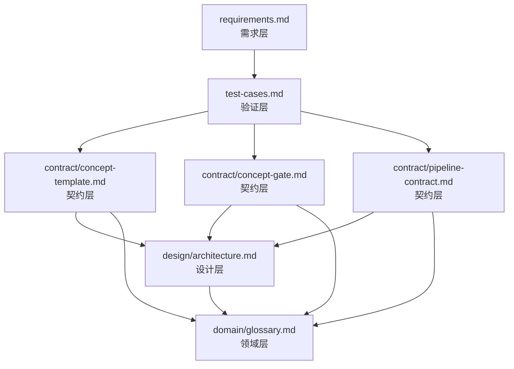

# Spec 目录分层架构

> 目标：为项目 spec 设计分层目录结构，实现「改一处不牵动全库」。
> 来源：腾讯《开启Harness Engineering》2.3.1 目录分层原则——单向依赖，下层不改上层。

---

## 1. 分层总览

```
requirements.md  ← 用户/业务想要什么（需求层）
      │
test-cases.md    ← 怎么验证做到了（验证层）
      │
contract/        ← 写 Concept / 管线 的格式契约（契约层）
      │
design/          ← 系统怎么搭（设计层）
      │
domain/          ← 基础定义：术语 / 概念格式（领域层）
```

**依赖方向：上层依赖下层，下层不改上层。** 箭头 = "依赖"而非"实现"。

---

## 2. 各层职责

| 层 | 目录/文件 | 包含内容 | 谁依赖它 |
|---|---|---|---|
| 需求层 | `requirements.md` | 功能需求 + Acceptance Criteria (AC-1~AC-6) | test-cases.md |
| 验证层 | `test-cases.md` | 测试用例 (TC-1~TC-6)，对应 AC | 手动/CI 执行 |
| 契约层 | `contract/concept-template.md` | Concept 模板契约（字段 + 段落） | Agent 提炼 Concept 时参考 |
| | `contract/concept-gate.md` | Gate 规则清单 (F1-F11) | `validate_concept.py` |
| | `contract/pipeline-contract.md` | 管线接口契约（输入/输出/Gate） | `pipeline2.py`、`fetch_articles.py` |
| 设计层 | `design/architecture.md` | 数据模型、目录结构、D-x 改动点 | 契约层引用 |
| | `design/pipeline-design.md` | Mermaid 数据流、状态机 | 契约层引用 |
| 领域层 | `domain/glossary.md` | 术语 SSOT 定义 | 所有上层 |
| | *(未来)* `domain/concept-format.md` | Concept 格式基础规范 | 契约层 |

---

## 3. 依赖关系图



**检查清单**：
- ✅ 无循环依赖（所有箭头单向向下）
- ✅ 需求层在最顶（改需求时向下传导）
- ✅ 领域层在最底（术语变更时向上广播）
- ✅ 每层职责单一，不跨层引用

---

## 4. 变更影响分析

### 场景 A：改一条业务规则

> 例如：修改 AC-4 的 Gate 校验范围（从 F1-F7 扩展到 F1-F11）

| 步骤 | 动哪个文件 | 原因 |
|------|-----------|------|
| 1 | `requirements.md` | 修改 AC |
| 2 | `test-cases.md` | TC-4 依赖 AC-4，需同步 |
| 3 | `contract/concept-gate.md` | Gate 规则清单是 F1-F11 的权威定义 |
| 4 | `contract/concept-template.md` | 如有新增字段，模板需对应 |
| 5 | `domain/glossary.md` | 如有新术语，更新术语表 |

传播路径：需求层 → 验证层 → 契约层 → 领域层。**不涉及 design/ 和 plans/**。

### 场景 B：改一个接口

> 例如：修改管线 2 的 Gate 校验结果处理逻辑（PASS/WARN/FAIL 三种结果的动作）

| 步骤 | 动哪个文件 | 原因 |
|------|-----------|------|
| 1 | `contract/pipeline-contract.md` | 接口契约是接口的权威定义 |
| 2 | `design/pipeline-design.md` | 管线设计图可能需要更新（状态机/数据流） |
| 3 | `contract/concept-gate.md` | Gate 规则级别如变化，同步更新 |
| 4 | `scripts/validate_concept.py` | 校验脚本实现需匹配新契约 |
| 5 | `test-cases.md` | 如有新增/修改测试场景 |

传播路径：契约层 → 设计层 → 脚本实现。**不涉及 requirements.md**（业务需求没变）。

---

## 5. 与当前 spec 目录的对照

| 当前文件 | 分层后的位置 | 说明 |
|---------|-------------|------|
| `specs/requirements.md` | `specs/requirements.md` | 不移动，需求层 |
| `specs/test-cases.md` | `specs/test-cases.md` | 不移动，验证层 |
| `specs/concept-template.md` | `specs/contract/concept-template.md` | 移入契约层 |
| `specs/concept-spec.md` | `specs/contract/concept-gate.md` | 移入契约层 + 重命名 |
| `specs/design.md` | 拆分为 `specs/design/architecture.md` + `specs/design/pipeline-design.md` | 拆入设计层 |
| `specs/clarify-draft.md` | 归档或删除 | 临时文档，已完成使命 |
| `specs/p3-plan.md` ~ `p6-plan.md` | `specs/plans/` | 移入计划子目录 |
| `glossary.md`（根目录） | `specs/domain/glossary.md` | 移入领域层 |

**迁移节奏**：待模块4（统一 Spec 模板）完成后统一执行，避免当前文件被多个工作流同时修改。

---

## 6. 设计决策记录

| 决策 | 理由 |
|------|------|
| requirements.md 单独放而非放入子目录 | 它是所有 Agent 进入项目时必读的入口文件，减少嵌套 |
| 契约层独立于设计层 | 契约是"什么"（What），设计是"怎么"（How）。改设计不应影响契约，但改契约必须检查设计 |
| 领域层不放 rules/ | 当前规则（Gate、筛选）跟具体实现紧耦合，放在契约层更合理。未来规则多了再拆 |
| plans/ 独立于正式 spec | 计划是临时性文档，完成后归档。不与稳定规范混放 |

---

> 最后更新：2026-07-31
> 参考：腾讯《开启Harness Engineering》2.3.1 — SSOT、目录分层、原位更新
